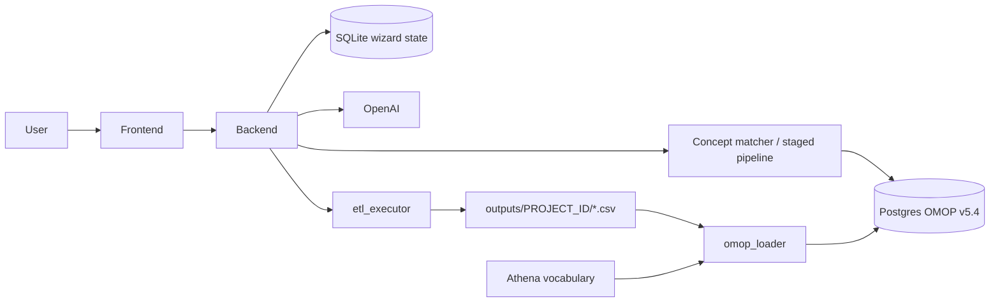

# OMOP ETL Auto-Designer

A code-less, browser-based ETL builder that converts any flat source CSV into an
OMOP CDM v5.4 compliant database. Users define all transformation logic through
a wizard UI (7 required steps + up to 4 optional OMOP table steps); OpenAI
generates the per-table Python transformations; a bundled Postgres container
with the full OMOP CDM v5.4 schema receives the loaded data.

---

## Architecture



```
ETL_auto_designer/
├── backend/                FastAPI + SQLite (wizard state)
│   ├── app/
│   │   ├── api/            REST routes
│   │   ├── services/       etl_executor, omop_loader, vocab_loader, code_generator
│   │   ├── prompts/        Per-table prompt templates for OpenAI
│   │   └── ...
│   ├── omop_ddl/           OHDSI CDM v5.4 DDL + PKs (applied by omop-init)
│   ├── uploads/            Uploaded source CSVs / mapping CSVs
│   ├── outputs/            Generated OMOP CSVs per project
│   ├── Dockerfile
│   └── requirements.txt
│
├── frontend/               React + Vite + TailwindCSS (slug-based wizard)
│   ├── src/
│   │   ├── pages/wizard/   SourceStep … FinalizeStep
│   │   ├── components/     Shared UI (ConceptSearch, ErrorBanner, …)
│   │   ├── hooks/          useTableConfig
│   │   ├── api/client.ts   Axios client
│   │   └── types/
│   └── Dockerfile
│
├── conceptmatcher/         The staged concept matcher (see below), built as the
│                           `conceptmatcher` service. Its own README covers the pipeline.
├── scripts/init-omop.sh    Calls python -m app.services.ddl_applier bootstrap to split vocab/clinical DDL into separate schemas
├── docker-compose.yml      Postgres + omop-init + conceptmatcher + backend + frontend
└── .env.example            Stack-wide environment variables
```

---

## Quick start (Docker — recommended)

```powershell
# 1. Copy and edit env file (set OPENAI_API_KEY)
copy .env.example .env

# 2. Bring the whole stack up
docker compose up --build
```

Services:

| Service        | URL                       | Notes                                        |
|----------------|---------------------------|----------------------------------------------|
| Frontend       | http://localhost:5173     | Vite dev server                              |
| Backend        | http://localhost:8000     | FastAPI + Swagger at `/docs`                 |
| Postgres       | localhost:5432            | `psql -U omop -d omop`                       |
| `omop-init`    | one-shot                  | Splits the OMOP v5.4 DDL into vocabulary and clinical buckets and applies each into its own schema (`${OMOP_VOCAB_SCHEMA}` and `${OMOP_SCHEMA}`). Idempotent via per-schema marker rows. |

The DDL splitting and application is owned by `backend/app/services/ddl_applier.py`. The `omop-init` service is a thin shell wrapper that waits for Postgres and invokes `python -m app.services.ddl_applier bootstrap`. Clinical sessions run with `search_path = <clinical>, vocab, public` so unqualified `concept` lookups resolve.

---

## Quick start (local Python / Node)

```powershell
# Backend
cd backend
copy .env.example .env       # set OPENAI_API_KEY
pip install -r requirements.txt
python -m uvicorn app.main:app --reload --port 8000

# Frontend
cd frontend
npm install
npm run dev
```

The DB-load card in the Finalize step is only fully functional when Postgres is reachable; you can still configure and generate all scripts without it.

---

## Environment variables

Set in repo-root `.env` (consumed by `docker-compose.yml`) and/or `backend/.env`:

| Variable                | Default                                | Purpose                                                       |
|-------------------------|----------------------------------------|---------------------------------------------------------------|
| `OPENAI_API_KEY`        | *(required for codegen / chat)*        | OpenAI API key — also enables the AI fallback of column auto-match |
| `OPENAI_MODEL`          | `gpt-4o`                               | Model used for code generation, the chat assistant and the column auto-match fallback |
| `DATABASE_URL`          | `sqlite:///./etl_designer.db`          | Wizard state DB (kept on SQLite for simplicity)               |
| `POSTGRES_USER`         | `omop`                                 | OMOP Postgres user                                            |
| `POSTGRES_PASSWORD`     | `omop`                                 | OMOP Postgres password                                        |
| `POSTGRES_DB`           | `omop`                                 | OMOP Postgres database                                        |
| `OMOP_DB_HOST`          | `postgres`                             | Backend uses this to reach Postgres (set to `localhost` outside Docker) |
| `OMOP_DB_PORT`          | `5432`                                 |                                                               |
| `OMOP_SCHEMA`           | `cdm`                                  | Target schema for the clinical CDM tables                     |
| `OMOP_VOCAB_SCHEMA`     | `vocab`                                | Target schema for the shared vocabulary tables                |
| `ATHENA_BUNDLE_ROOT`    | *(empty)*                              | Allow-list root for `/load-vocabulary` (security guard)       |
| `MAPPINGS_BUNDLE_ROOT`  | *(empty → uploads dir)*                | Allow-list root for `/load-mappings-from-dir`                 |
| `CONCEPT_MATCHER_URL`   | (inside Docker: `http://conceptmatcher:8000`) | Concept matcher behind every concept search and the Concepts step's "Load concepts" button. Empty disables them. |
| `CONCEPT_MATCHER_PORT`  | `8002`                                 | Host port the matcher is published on                         |
| `CONCEPT_MATCHER_EMBEDDINGS` | `1`                               | Build arg. `0` drops Stage 5 and shrinks the image ~2GB → ~310MB; the remaining stages' weights are renormalized rather than scored zero |

---

## Automatic concept matching (Concepts step → "Load concepts")

Every concept finder in the app goes through one service, `conceptmatcher` —
the staged pipeline in `conceptmatcher/` — over the stack's own vocabulary
(`vocab` schema), returning **standard + valid concepts only**. It is used two ways:

| | **Search** (per row / per field) | **Load concepts** (whole project) |
|---|---|---|
| endpoint | `GET /projects/{id}/search-concepts` | `POST /projects/{id}/match-concepts` (+ `/match-values`) |
| answers | "what concepts look like this phrase?" — a ranked list you pick from | "what is this column?" — one concept per column, plus a decision |
| you get | the matcher's shortlist, topped up by a name search and grouped under parents | `auto_accept` / `review` / `unmapped` per column, with a confidence |
| domain | the field's own; none on a Concepts step variable, where each result shows its domain | the domains the run asks for |

### What the matcher actually is

It is not a second embedding search. It is a ten-stage pipeline over the
standard, valid concepts of the Athena vocabulary (3,518,557 of them), one
module per stage in `conceptmatcher/pipeline/`, driven by its `runner.py`:

| stage | what survives |
|---|---|
| 0 preprocess | identifier splitting, abbreviations, units, codes, dates, phrases, stopwords, lemmas → **1..N interpretations** of the input |
| 1 exact / code | manual mapping → code → exact name → exact synonym. **A hit exits at 100** |
| 2 full-text search | Postgres FTS, 4-rung query ladder, ≤30 candidates |
| 3 weighted Jaccard | IDF-weighted token-set overlap, ≤15 |
| 4 fuzzy | trigram / Levenshtein / acronym-by-initials, ≤10 |
| 5 embeddings | MiniLM cosine; re-scores, eliminates nothing |
| 6 composite | weighted score → `auto_accept` / `review` / `unmapped` |
| 7 validate + log | validation flags, mapping log, feedback store |
| 8 batch | thread pool + caches — **this is the path `/match` takes** |
| 9 report | reporting views |

Stages 2–5 run once per Stage 0 interpretation and stage 6 keeps the best score
per concept across all of them. Composite score is
`35% FTS + 25% Jaccard + 20% fuzzy + 20% embedding`, renormalized over whichever
stages actually produced a score — a stage that did not run is not counted as
zero. Then ≥ 90 auto-accepts, ≥ 70 goes to review, below that is unmapped after
one retry with the domain filter dropped.

Two consequences are worth carrying in your head while using the step:

- **A Stage 1 exact hit exits at 100 before Stage 6 ever runs**, so none of the
  composite scoring or its penalties apply to it. That is why Stage 1 carries
  its own hard filters rather than relying on later stages to correct it.
- **The lexical stages do most of the work.** Turning embeddings off costs
  nothing measurable on column-name matching (gold set: 92.0% without, 90.0%
  with) and saves ~40 ms/column. They are on as insurance for inputs where the
  lexical stages have little to grip.

Full documentation is the matcher's own [`README.md`](conceptmatcher/README.md)
(~950 lines, including every measured dead end). Read it before changing
anything matcher-side; nothing about the stages is configurable from the wizard.

### Give it descriptions first

The matcher's accuracy hinges on what it is given. A column *name* is an
identifier — `DOC_PAT_HAIR`, `creat_mgdl` — while a description is prose a
vocabulary can actually be searched with, and the pipeline searches both. Same
project, `city` as the only input versus `city` + "City of residence": the
second is an exact hit on concept 4335813 at confidence 100; the first is a
guess.

So the **Descriptions** button next to *Load concepts* opens the project's data
dictionary:

- **Download template** — a CSV of every source column (`name,table,description`),
  pre-filled with whatever is already stored, so it doubles as an export.
- **Upload CSV / Excel** — merges a dictionary in (tick *Replace* to start over).
  Bring whatever you already have: `.csv`, `.tsv` or `.xlsx`; delimiter and
  encoding are sniffed; the header row can say `name`/`column`/`variable`/`field`
  and `description`/`definition`/`label`/`meaning`; column names match regardless
  of case, spaces or underscores; other columns are ignored. Rows naming a column
  the project doesn't have are reported back, not dropped silently.
- Each row also has an editable **Description** field, for fixing one entry
  without another round-trip through a spreadsheet.

Descriptions live on the project (`projects.column_descriptions`) and the backend
attaches them to every match request, so they apply no matter where the match is
triggered from.

### Running it

Every variable starts on **Map variable**, so one click on **Load concepts**
maps the whole project. It sends every included, still-unmapped column — across
*all* source files, not just the selected one. A variable that already has a
concept is never overwritten.

A variable switched to **Map values** (or **Map both**) is matched too, but by
its values rather than by its name — see the next section. The button's count is
the number of pieces of work queued, so a *Map both* variable counts twice.

What happens to each answer depends on how sure the pipeline was:

| its verdict | what the step does |
|---|---|
| **auto-accept** (≥ 90) | sets the concept, with a green confidence chip on the row |
| **review** (70–90) | **sets nothing.** The row offers the 5 ranked candidates, best first and marked *Best match*, for you to click |
| **unmapped** (< 70) | leaves the row untouched |

Two further outcomes are bucketed separately in the summary panel: **off-domain**
(a concept came back, but its domain is not one of the five domain tables this
wizard generates) and **failed** (the pipeline errored on that column).

The review case is the one that matters. A serum-creatinine column, for
instance, comes back at 82 with *Creatinine in peritoneal fluid/Creatinine in
serum* on top — while the concept you actually want, *Creatinine [Mass/volume]
in Serum or Plasma*, is fourth on the same shortlist, 2.7 points behind.
Writing the leader would have been quietly wrong; showing all five and letting
you pick takes one click and is right.

Rows awaiting a choice are badged while collapsed and have their own **Review**
filter in the toolbar, and the shortlists are saved with the rest of the step,
so a run survives a reload.

A results panel at the top sums up the run: variable and value counts side by
side as coloured bars (set, to pick, unsupported domain, unmapped, failed), then
a **Needs your attention** list of the affected columns as chips, and a
collapsible per-column table of the value results, columns needing work first.
Clicking a column filters the list to it; it does so with a quoted search
(`"PAT_MED_HIST"`), which matches that name exactly instead of every column
containing it — the same works when typed into the filter box. The panel is kept
in the browser per project, so it too survives a reload, until dismissed or
replaced by the next run.

### Variables mapped by value: two passes, one domain

A **Map values** variable has no single concept to find — each of its distinct
values is its own concept (`HTN` → *Hypertensive disorder*), and all of them have
to land in the **same** OMOP domain, because they all become rows of one
stem-table domain. Which domain that is, though, is only apparent once the values
have been looked up. So such a column is matched in two passes, per column:

1. **Pass 1** matches every distinct value with no domain restriction, and the
   domains that come back are counted. The most frequent one wins — among the
   five stem-table domains if any of them appear at all, since a concept outside
   them produces no usable row. A tie goes to whichever domain the column's first
   values pointed at.
2. **Pass 2** throws away every concept outside the winning domain and searches
   those values again with the matcher confined to it (the pipeline's `/match`
   takes a `domains` restriction per request). A value whose best overall match
   was off-domain therefore gets the best *in-domain* one instead of being
   dropped, and candidates outside the domain are stripped from the shortlists.

Each value is sent **on its own**, without the column's name or description.
The matcher folds a description into the query, which helps a column but drowns
a value: next to `PAT_MED_ARD_NAME_1`, "Prednison" fell from auto-accept 97.0 to
unmapped 57.8, and even a written description pulled in wrong concepts. The
domain vote already supplies the context a value needs.

A **yes/no column** — every value is a yes/no word (`yes`/`y`/`true`/`present`,
`no`/`n`/`false`/`absent`) or a missing-data marker, with at least one yes — is
the exception. "Yes" alone only finds the answer concept *Yes*; its meaning is in
the column ("Are there any swollen joints?"). So the **column** (name +
description) is matched once instead, restricted to the five stem domains; every
"Yes" takes that concept, every "No" is set to 0 (not mapped), missing markers
are left open. The column's domain is recorded only when a value actually got a
concept, so a column of unresolved answers keeps the domain it had.

Measured on 647 hand-mapped values of the PsA study (`benchmarks/
compare_value_mappings.py` in the matcher's repo), the share of values that are
right or one click away went from 48.1% (value + column name) to **73.3%**
(value alone + yes/no handling), and 64 of the 99 values deliberately left at 0
are now set to 0 automatically.

The per-value verdicts are then handled exactly like the per-column ones:
auto-accept sets the concept, review leaves the value's own 5-candidate shortlist
on its row, unmapped leaves it alone. A value you had already decided is never
touched. If the domain the values agreed on is *not* one of the five — nothing
stem-table-shaped can be built from it — nothing is set for that column at all,
and the results panel marks that domain as unsupported. The panel's value-columns
table shows, per column, the domain its values were confined to and how many
were set, left to pick, unmapped or failed; the row badges how many of its values
are waiting on a choice.

Values are read server-side from the source CSVs (up to 500 distinct values per
column), so this works for columns of files other than the selected one. Columns
are sent one per request, which is what the per-column domain vote requires and
what lets the button report progress — a value run is much longer than a variable
run.

### What to expect from it

Measured on the matcher's two benchmarks — 50 lab/vitals columns graded by name
rule, and 206 real curated columns from a rheumatology study graded by
concept_id (117 of them with a standard Athena answer, the rest custom ids
≥ 2e9 and one non-standard concept):

| | value |
|---|---|
| gold set, overall / literal / top-5 | 92.0% / 97.8% / 96.0% |
| gold set, accuracy within auto_accept | 100% |
| curated columns, exact concept_id (117) | 30.8% |
| curated columns, agreed on meaning | 60.7% (heuristic; over-counts by ~7) |
| curated columns, correct concept in top-5 | 58.1% |
| throughput | ~700 ms/column, 4 workers |

Custom concepts are searchable too: the matcher reads the same vocabulary the
Finalize step writes them into, once `scripts/setup-conceptmatcher.sh` has run
again. On the same study, with its 158 custom concepts loaded, it found 44 of
the 88 custom answers (24 auto-accepted) and returned none of the other 8 as
anything but unmapped. They are shared, though: a custom concept loaded for one
project is offered to every project.

Read that as: **auto-accepts have been reliable, and the review queue is where
the real work is.** On a 32-column synthetic EHR schema the split was 18
auto-accept / 12 review / 2 unmapped, and both genuinely wrong answers were in
the review queue rather than accepted, each with the right concept visible in
its candidate list. That is the behaviour the step is built around.

Measured against the SapBERT + FAISS search this app used before (since
removed), the matcher wins by ~3× on questionnaire items, opaque variable names
and prose (114 curated columns, top-5: **59.6%** vs 18.4%). It is slightly
behind on short canonical lab terms (50 lab columns, top-1: 90.0% vs 94.0%) —
if a bulk run leaves a short lab column unmapped, a Search on that one row with
a reworded term is the right follow-up.

### Three limits that will bite

**Source-vocabulary codes resolve only when labeled.** The matcher returns
standard concepts only, but it reads the full vocabulary Card 1 of the
Finalize step loads, so a source code is followed through its `Maps to` edge to
the standard concept OHDSI curated for it: "ICD-10: E11.9" gives Type 2
diabetes mellitus. Only a code the text labels is followed — a bare
ICD-10-shaped token is usually a questionnaire item number (`Q14`) and is left
alone. CPT-4, ATC and ICD-9 codes still do not resolve (see the matcher's
README, Limitations); an unresolved code gets an explicit validation flag
rather than a quiet fall-through to a name match.

**Variables versus values is the largest open defect.** OMOP holds both the
concept naming a variable and many concepts naming statements *about* it, and
the pipeline cannot reliably prefer the former: `height` returns
`4203099 Normal height` (Clinical Finding) rather than `3036277 Body height`;
"What is your profession?" returns `4076340 Employed` rather than
`36203487 Occupation [Type]`. Four separate attempts to fix this by penalising
extra words are recorded as measured failures in `conceptmatcher/README.md`. This is
the main reason the review queue exists — skim it for this shape of error
specifically.

**The domain restriction exists in the pipeline but this wizard never sends
it.** `POST /match` accepts a `"domains"` allow-list, which costs no accuracy
and cuts ~38% of the latency when it is right, and it is the only tool that
touches the defect above (`--domain Measurement` puts `Body height` in the top
two). [`MatchConceptsPayload`](backend/app/api/concept_mapping.py#L262) has no
such field, so every run here is unrestricted. Worth adding if your project is
single-domain — a study's lab panel, one questionnaire.

### Bringing the matcher up

The matcher reads the same Athena vocabulary as the rest of the stack — the
`vocab` schema in `postgres` — and keeps its search structures (a search
matview, IDF weights, a spelling dictionary, its logs and feedback) in a
`pipeline` schema next to it. Build that once the vocabulary is loaded:

```bash
# Finalize step, card 1: load the Athena bundle (once)
./scripts/setup-conceptmatcher.sh        # ~5 min on a full Athena export
docker compose restart conceptmatcher
curl localhost:8002/health
```

**Re-run the script after every vocabulary reload.** The search structures are
derived from `vocab.concept` and do not follow it on their own; until the
script runs again the matcher keeps answering from the previous release.
Custom concepts the Finalize step inserts (ids ≥ 2,000,000,000) become
searchable the same way, on the next run of the script.

The script also adds four indexes the matcher needs to the vocab tables
(synonyms by name and by concept, concepts by code, `Maps to` lookups), about
2 GB on a full export. A vocabulary reload keeps them up to date as it copies,
which makes the reload slower than without them.

The service is `conceptmatcher/pipeline/service.py`, run as `serve`. Until it
is ready, "Load concepts", "Auto-fill concept IDs" and concept search are
disabled — every step still works by hand.

### Checking on it

Every wizard step's header shows **Concept matcher: ready / starting /
unavailable** (green / amber / red). Click it for the reason, the fix as
copyable commands, the raw error under *Details*, the time of the last check,
and a **Re-check** button; when ready it shows the vocabulary version and
concept count. The status is re-checked every 30 s until the matcher is ready
(every 5 min after) and whenever the tab regains focus, so "Load concepts"
turns itself on once a fix lands — no page reload.

The backend's `GET /api/projects/concept-matcher/health` does the diagnosis and
returns `{status, reason, hint, commands, raw}`:

| What the backend sees | Status | Fix |
|---|---|---|
| `CONCEPT_MATCHER_URL` empty | not configured | set it, restart the backend |
| connection refused / host not found | unavailable | `docker compose up -d conceptmatcher` |
| no answer within 10 s | starting | wait — it loads the embedding model at startup |
| 503 "pool … already closed" | unavailable | `docker compose restart conceptmatcher` (older matchers only; the pool now reopens by itself) |
| 503 connection error to Postgres | unavailable | `docker compose up -d postgres`, then restart the matcher |
| `missing: vocab.concept` | unavailable | load the vocabulary (Finalize step), then run the setup script |
| `missing: pipeline.…` / empty IDF table | unavailable | `./scripts/setup-conceptmatcher.sh`, then restart the matcher |

### Keeping it current

`conceptmatcher/pipeline/` and `conceptmatcher/data/` are bind-mounted over the
image's own copies, so a changed
threshold, stopword list or scoring stage does **not** need a rebuild. What it
does need is a restart, because unlike the CLI — one-shot, so it re-reads
everything on each invocation — this is a long-running process that imported the
code once at startup:

```bash
docker compose restart conceptmatcher     # after editing the pipeline
docker compose build conceptmatcher       # only for requirements.txt changes
```

A stale matcher is otherwise invisible: it keeps answering, just with the old
ranking. `docker exec omop-conceptmatcher md5sum /app/pipeline/config.py`
against the host file settles it.

### Debugging a wrong answer

Nothing in this wizard explains *why* a column got the concept it got — the UI
shows a score and a shortlist, not the arithmetic. Take the question to the
matcher's CLI, which prints the full per-stage breakdown:

```bash
cd conceptmatcher
./pipeline.sh match --name creat_mgdl --description "Serum creatinine mg/dL" --explain
```

`--explain` first: most wrong answers are one stage overpowering the others
rather than a missing feature, and it shows which stage chose the winner.
`./pipeline.sh shell` is the same thing interactively, with the embedding model
loaded once (~250 ms/query instead of a ~10 s model load per invocation).

Tuning lives entirely in `conceptmatcher/`:

| what | where |
|---|---|
| thresholds, weights, feature flags | `data/pipeline.json` (copy its `pipeline.example.json`); `PIPELINE_CONFIG` already points the container at it |
| abbreviations, units, phrases, stopwords, equivalents | `pipeline/resources/*_local.*` — merged over the shipped defaults, so they survive updates |
| a human correction, remembered | `./pipeline.sh feedback --column … --concept … --source-system <project id>` — Stage 1 short-circuits to it from then on |

Both of the first two take effect on `docker compose restart conceptmatcher`,
no rebuild. The feedback store is scoped by `source_system`, and this backend
sends the **project id** as that value, so a correction recorded for one project
never leaks into another's.

---

## Column auto-match in the table steps

Every table step (Location, Care Site, Provider, Person, Visit, Observation
period, Death) asks, field by field, which source column holds what.
**Auto-match columns** at the top of each step makes that first pass: it scores
every source column against every *empty* field, fills in the confident matches
and offers the rest as *Suggested: … Use* under the field. Fields already mapped
are never sent, so re-running it is safe. The pipeline lives in
[`column_matcher.py`](backend/app/services/column_matcher.py), behind
`POST /projects/{id}/suggest-column-mapping`.

```
empty fields ──► profile the file ──► name score × value check ──► one column per field
                                                                        │
          date format ◄── AI fallback (fields still unsure) ◄───────────┘
```

**1. What the step sends.** The empty fields; the file(s) to look in (the active
file tab — for Observation period, the file picked for that date, or every file
when none is); the columns to skip (anything already mapped in this or another
step, the same rule the dropdowns use); for Visit, each visit's label as a hint;
for date fields, the step's date format and whether another mapped column uses it.

**2. Profiling.** The first 5,000 rows are read as text and up to 500 distinct
values kept per column. From those: the share that look like dates, times or
years, are numbers (and in latitude / longitude range), match a zip, NPI or DEA
pattern, or look like gender codes; and how many distinct values there are.
Profiles are cached until the file changes.

**3. Field specs.** Each field has a kind (`date`, `id`, `gender`, `category`,
`text`, `zip`, `latitude`, …), a one-line description and the names it tends to
go by — date of birth is `dob`, `birth date`, `year of birth`, `fecha nacimiento`…
Care-site fields are the location names with a site word in front (`hospital
city`, `facility zip`), so a plain `city` goes to the patient and `hospital_city`
to the care site. Provider gender and year of birth need a provider word
(`doctor_gender`), so the patient's `gender` is not taken.

**4. Name score.** Names are split into words — `PatBirthDt`, `pat_birth_dt` and
`pat-birth dt` all become *pat, birth, dt* — and filler words (*of*, *the*) dropped.
The best score over the field's names counts:

| case | score |
|---|---|
| same name, ignoring case and punctuation | 1.0 |
| every word of the name is in the column | 0.92, −0.05 per extra word, −0.25 more per extra word naming another kind of field (*date, id, city, birth, name, address…*) |
| a name of 5+ letters inside an unseparated column name (`patientbirthdate`) | 0.72 — a suggestion at most (`ethnicity` holds `city` the same way) |
| a 3-letter name at the start or end of a one-word column (`patdob`) | 0.7 |
| near-identical spelling (`adress`) | similarity × 0.8 |
| some words in common | share × 0.6 |

An abbreviation counts only as a real shortening of 4+ letters (`addr` →
`address`, not `doc` → `doctor`). With a data dictionary loaded (Concepts step →
Descriptions), a description containing all the words of a name scores 0.85. For
Visit, a name combined with the visit's label scores in full and the bare names
10% less, so the *Follow-up* visit gets `followup_date`, not `baseline_date`.
Columns scoring under 0.35 are dropped.

**5. Value check.** The values are tested against the field's kind — dates must
parse, latitudes sit within ±90, an id has many distinct values, a category few.
The score becomes **name × (0.65 + 0.35 × value)**, and a column whose values
plainly are not that kind is multiplied by 0.3 — below the suggestion threshold,
so `admission_type` never becomes an admission date. Values confirm or weaken a
name; they never stand in for one.

**6. Assignment.** All field–column pairs are taken best score first, so each
column fills at most one field. **≥ 0.75** is filled in, **0.45–0.75** suggested,
lower not offered; up to three alternatives are kept per field.

**7. AI fallback.** Fields not filled in are sent, with the columns nobody
claimed (up to 5 sample values each, and their descriptions), to the OpenAI model
in `OPENAI_MODEL`. It must answer with column names from that list: an invented,
excluded or doubly-used column is discarded. A pick is filled in only at
confidence ≥ 0.7 *and* if its values pass step 5; otherwise it is a suggestion
marked *AI*. If the call fails, the name-and-value results stand.

The badge beside the button says whether the fallback can be used —
**ready · gpt-4o** (key and model verified with one cheap request, cached five
minutes), **off** (no `OPENAI_API_KEY`) or **error** (hover for why) — and
clicking it checks again (`GET /projects/column-matcher/health?refresh=1`).
**Use AI** turns it off per browser.

**8. Date formats.** The generated scripts parse dates with the one `strptime`
format set on the step and skip rows that don't fit it, so finding the column is
only half the job. For each matched date column, about 70 formats (`%Y-%m-%d`,
`%d/%m/%Y`, `%m/%d/%Y`, timestamps, `%Y` for a year of birth…) are tried on up to
200 values and the one that reads the most is kept:

- it differs from the step's format → the step's format is set to it, unless a
  date column already mapped relies on the current one (Visit start and end
  share a format per visit; Observation period start, end and fallbacks share
  one; Death date and datetime share one) — then the column is only suggested,
  with a warning;
- two empty fields sharing a format disagree → the better match sets it, the
  other is suggested;
- under 95% of the values fit → suggested, since the rest would be skipped;
- day and month can't be told apart (every day ≤ 12) → day-first, with a warning.

**9. Back in the step.** A filled-in column goes through the same handler as a
manual pick, so the value list loads and **Auto-fill concept IDs** (below) can
map its values. **Use** on a suggestion sets its date format too. A summary lists
what was filled, suggested, not found, and which date formats were set.

### Auto-map all steps

**Auto-map all steps** on the Source step walks every active table step in turn
(never Concepts): on each it presses **Auto-match columns**, then **Auto-fill
concept IDs**, for every selected file, saves the step and moves on — a bar at
the top shows progress and can stop it. It ends back on the Source step with a
per-step report. Suggestions are not kept across steps; open a step and press
Auto-match columns again to see them. A step whose data doesn't load within 30 s
is skipped with an error. The driver is
[`useAutoRunStep.ts`](frontend/src/hooks/useAutoRunStep.ts); each step passes it
its own targets and save, so it does exactly what the buttons do.

What auto-match does *not* check: time formats (visit times, birth time keep
`%H:%M:%S`), and columns picked by hand.

---

## Concept IDs in the table steps (auto-fill + search)

The table steps ask for standard concept ids per source value — gender, race,
ethnicity, country, place of service, specialty, visit concept and type, and so
on. Rather than looking each one up on Athena, the
same matcher fills them in and searches them, with one difference from the
Concepts step: the **domain is known up front** (a gender value can only be a
Gender concept), so every request is confined to it.

- **Auto-fill concept IDs** (top of the Location, Care Site, Provider, Person
  and Visit steps) sends every *unmapped* value of the step's concept columns
  through `POST /projects/{id}/suggest-value-concepts`. Confident matches are filled in;
  weaker ones appear under the value as *Suggested: … Use*; the rest stay empty.
  Values already mapped are never touched, so re-running it is safe.
- **Search** (🔍 beside every value, and beside the *Set default* inputs, in all
  seven table steps — Observation period and Death too) calls
  `GET /projects/{id}/search-concepts`, restricted to the field's domain. The
  matcher is asked for its full shortlist (`"shortlist": true`): normally an
  exact concept name ends its search with that one concept, so *Native Hawaiian*
  came back without *Native Hawaiian or Other Pacific Islander* (8557). With the
  flag it keeps ranking alternatives behind the hit, without changing the hit
  itself. Auto-fill asks for the same, which is what fills the *Suggested* list.
  The shortlist is then topped up with a plain name search over the vocabulary
  (every word must appear in the name), which catches partial words (*hisp*)
  the matcher finds nothing for.
  Results are arranged as a **tree of broader → narrower concepts** (from
  `concept_ancestor`, nesting as deep as it goes — *Ambulance Visit › Ambulance ›
  Ambulance - Air or Water › Air Ambulance*), then the matches with no relatives
  among them.
- A set id shows its name in brackets — `8516 (Black or African American)`.

| step | field | domain | auto-fill picks from |
|---|---|---|---|
| Location | person / care site country | Geography | country-level concepts only (SNOMED *Location*, OSM *2nd level*) |
| Care Site | place of service | Visit | CMS Place of Service |
| Provider | specialty, gender | Provider, Gender | — |
| Person | gender, race, ethnicity | Gender, Race, Ethnicity | race rolled up (below) |
| Visit | visit concept | Visit | the Visit vocabulary (9201 Inpatient Visit, not 8717 Inpatient Hospital) |
| Visit | visit type | Type Concept | — |
| Visit | admitted from, discharged to | Visit | CMS Place of Service |
| Obs. period, Death | period type, cause of death | Type Concept, Condition | search only (single fields, no value table) |
| Concepts | unit, route (per variable) | Unit, Route | units by UCUM code (below) |

Where a field wants one vocabulary of its domain, the request carries a `prefer`
(vocabularies and/or concept classes): the best-scoring preferred candidate wins,
and with none in the shortlist the match is only offered, never filled. An exact
name tie the matcher collapses (*Canada* returned as the OSM place *Canadá*) is
resolved by an exact-name lookup restricted to the preference.

### Units and routes (Concepts step)

The Concepts step's **Auto-fill units & routes** button runs the same procedure
for every included variable whose Unit or Route card is in *From column* mode:
each distinct value of the unit / route column is matched in the `Unit` /
`Route` domain, confident matches are set, weaker ones wait on the value's row
under *Suggested … Use*, and values already set are never sent. Only the selected
file's values are loaded in that step, so a column of another file is filled
when that file is selected. Suggestions live until the page is reloaded.

Two kinds of value are resolved before the matcher is asked:

- **Units by UCUM code.** The matcher searches concept *names* ("milligram"); a
  unit column holds *codes* ("mg"), and searched as text "mg" landed on
  *nanomole per minute per mg of protein*. So units are looked up by
  `concept_code` among standard UCUM concepts: exact code first, then
  case-insensitively when only one concept fits (`mg/ml` → mg/mL); common
  non-UCUM spellings are translated first (mcg → ug, IU → [iU], cc → mL,
  tablets → {tbl}, puffs → {actuat}). A value with an amount in it ("2,5mg") is
  only offered; a number or a date is skipped.
- **"None" values.** In unit and route columns, unknown / not applicable / other /
  n/a / none / missing are set to 0 (not mapped).

Routes otherwise go to the matcher after the normalizer's synonyms (PO, IV, IM,
SC, PR, SL, eye drops, patch, "Sub cut injection", "injection (unspecified)" →
*Injectable*) and two phrase patterns (a joint injection → *Intra-articular*; a
cream / ointment / gel → *Topical*). Inhaled drugs go to *Respiratory tract*,
the OHDSI convention — the Route domain has no "Inhalation".

### Why values are rewritten before matching

Raw demographic values are poor input for a text matcher: `M`, `man`, `greece`
and `PRT` come back unmapped, and `non-hispanic` scores closest to *Hispanic or
Latino* — the opposite concept. So
[`concept_normalizer.py`](backend/app/services/concept_normalizer.py) rewrites
each value for its domain first:

| domain | rule | example |
|---|---|---|
| Gender | resolved outright from a word list (English, Spanish, French, German, Greek) — only two standard concepts exist | `M`, `man`, `Άρρεν` → 8507; `f`, `Woman` → 8532 |
| Race | synonyms; country name / ISO alpha-3 → nationality | `caucasian` → White; `China` → Chinese |
| Ethnicity | negations; country name / ISO alpha-2 / alpha-3 → nationality | `non-hispanic` → Not Hispanic or Latino; `greece`, `GR`, `PRT` → Greek, Portuguese |
| Geography | country name / ISO alpha-2 / alpha-3 → the country's name | `GR` → Greece; `USA` → United States (raw, it matches the village *Usa*) |
| Visit | abbreviations | `ER`, `ED` → emergency room; `IP`, `OP`, `ICU`, telemedicine → telehealth |
| Provider | shorthand; *-ologist* → *-ology* | `GP` → General Practice; `Cardiologist` → Cardiology |

The rewritten term (never an id) is then matched within the domain, so the
vocabulary decides the concept. The country table lists ~170 countries, and
every nationality in it was checked to be a standard Race or Ethnicity concept
name. Deliberate gaps:

- **Numeric gender codes** (`1`/`2`) are not guessed — datasets disagree on which is which.
- **Two-letter country codes are ethnicity-only**; race columns use short codes that collide (`AI`).
- **Unknown countries** pass through unchanged and usually stay unmapped — add a row to `_COUNTRIES`.
  Of its ~170 countries, all but Bermuda, Palestine, Réunion and Western Sahara have a
  country-level Geography concept; those four are only ever suggested.
- The mapping assumes the column means nationality. A country-of-birth column is mapped just as confidently, and wrongly.

### Race: rolled up to the five OHDSI categories

The OHDSI convention for `person.race_concept_id` is one of 8527 White, 8516
Black or African American, 8515 Asian, 8657 American Indian or Alaska Native,
8557 Native Hawaiian or Other Pacific Islander (the original value goes in
`race_source_value`). A text match on *Black* lands on the narrower 38003598, so
auto-fill rolls every race match up to its top-level ancestor
(Black → 8516, Chinese → 8515, European → 8527). Only ~45 race concepts sit under
those five; a match outside them (*Black African*, *White Roma*) is offered as a
suggestion, never filled on its own. Search is not rolled up — a detailed concept
can still be picked deliberately.

Ancestry and the bracketed names are read from the backend's `vocab` schema
(Finalize → Card 1). Without it loaded, search and auto-fill still work, but
nothing is rolled up or grouped, and ids show without names.

That schema needs two indexes, which the vocabulary loader builds after every
load (OHDSI's own names, from `omop_ddl/OMOPCDM_postgresql_5.4_indices.sql`):
`idx_concept_domain` on `concept(domain_id)` (~70 MB) and
`idx_concept_ancestor_dec` on `concept_ancestor(descendant_concept_id)`
(~650 MB). Without them each search reads all of `concept` (~10M rows) and
`concept_ancestor` (~85M rows) — ~3 s per search even in a two-concept domain
like Gender; with them, 50–350 ms. A vocabulary loaded before the loader did
this can get them by re-running the load, or directly:

```bash
docker compose exec postgres psql -U omop -d omop -c "CREATE INDEX IF NOT EXISTS idx_concept_domain ON vocab.concept (domain_id)" -c "CREATE INDEX IF NOT EXISTS idx_concept_ancestor_dec ON vocab.concept_ancestor (descendant_concept_id)"
```

Each step wires this through `useConceptAutoFill` (one target per concept
field: domain, preference, values, and how to merge the filled ids) and the
`ValueConceptMapper` / `SingleConceptInput` components, which show search
whenever they get a `projectId` and a domain.

---

## Wizard walkthrough

Steps 2–4 and Death are optional (toggled from the Source step's table picker). All others are required.

| Step (slug)       | Page                       | Purpose                                                                                                                          |
|-------------------|----------------------------|----------------------------------------------------------------------------------------------------------------------------------|
| `source`          | Source upload              | Drop in your flat CSV — delimiter, encoding and columns are auto-detected. Toggle optional OMOP tables here. **Auto-map all steps** runs column auto-match and concept auto-fill on every table step (see above). |
| `location` *      | Location                   | Map address columns (city, state, county/country) for both person and care site, with separate country-concept mappings. Auto-fill + search for country concepts. |
| `care-site` *     | Care Site                  | Configure care_site name + place_of_service. Warns if Location has no `cs_*` columns mapped. Auto-fill + search for place of service. |
| `provider` *      | Provider                   | Provider source value, gender default, specialty mapping (prefix or value-map). Help text clarifies precedence. Auto-fill + search for specialty and gender. |
| `person`          | Person                     | Person ID, gender, DOB strategy (full date vs year-only), race/ethnicity. Shows the FK columns inherited from earlier steps. **Auto-fill concept IDs** and per-value domain search replace Athena lookups (see above). |
| `visit`           | Visit                      | Define multiple visit timepoints. Each gets a stable internal id; `visit_source_value` is auto-computed as `{person}|{label}`. Auto-fill + search for visit concept, type, admitted from / discharged to. |
| `obs-period`      | Observation period         | Start date is required; period-type uses a dropdown of standard OMOP concepts.                                                   |
| `death` *         | Death                      | Inline help clarifies filter semantics (empty filter → all rows treated as deceased).                                            |
| `concepts`        | Concept mapping            | Per-column decision, defaulting to **Map variable**. Upload a data dictionary under **Descriptions**, then **Load concepts** maps every variable at once through the staged matcher — and every distinct value of the **Map values** variables, two passes so all of a variable's values share one domain (see above); per-row Search and manual entry handle the rest. Gate-on-progress before next. |
| `stem-table`      | Stem table                 | Variable groups derived from the visit labels defined in the Visit step. Structural FK columns hidden from the picker.           |
| `finalize`        | Generate + Load            | Generate all scripts (or per-table), execute them in dependency order with per-table logs, then load results into Postgres. Two cards: **Card 1** bulk-loads the Athena vocab bundle; **Card 2** bulk-COPYs the project's output CSVs and optionally applies indices + FK constraints. |

\* optional — only shown when enabled from the Source step.

---

## Execution model

`etl_executor.execute_etl_scripts` runs **one Python subprocess per generated table**, in the dependency order
`location → care_site → provider → person → visit_occurrence → observation_period → stem_table → death`,
sharing `ETL_OUTPUT_DIR` so each script can read its predecessors' output. The per-table status, log
fragment, row count and elapsed time are returned to the UI and surfaced on the Finalize step.

---

## OMOP CDM v5.4 DDL

`backend/omop_ddl/` ships with the OHDSI Postgres DDL + primary keys vendored from
[CommonDataModel v5.4](https://github.com/OHDSI/CommonDataModel/tree/v5.4/inst/ddl/5.4/postgresql).
The vendored DDL file intermingles vocab and clinical `CREATE TABLE` statements;
[`backend/app/services/ddl_applier.py`](backend/app/services/ddl_applier.py) parses it at import
time, buckets statements by table name (`VOCAB_TABLES` list), and applies each bucket into a
separate schema:

- Vocabulary tables (concept, vocabulary, …) → `${OMOP_VOCAB_SCHEMA}` (default `vocab`)
- Clinical tables (person, visit_occurrence, …) → `${OMOP_SCHEMA}` (default `cdm`) or a
  project-scoped schema picked in the Finalize step.

Per-schema `__ddl_marker` rows make application idempotent. Indices and FK constraints are
**not** applied by `omop-init`; they're triggered from the Finalize step when the user ticks
"Apply indices and FK constraints after load".

---

## Loading OMOP outputs into Postgres (Finalize step)

The Finalize step is split into two cards.

**Card 1 — Vocabulary** calls `POST /api/load-vocabulary` after auto-detecting an Athena
bundle at `/vocab` (overridable via free-text). The backend ensures the `vocab` schema and
its DDL exist, then `vocab_loader.py` truncates and bulk-loads each `<TABLE>.csv` with
`COPY ... WITH (FORMAT csv, DELIMITER E'\t', HEADER, QUOTE E'\b')`. Per-file progress is
polled via `GET /api/vocab-status`.

**Card 2 — ETL** calls `POST /api/projects/<id>/load-database` with the chosen
`schema_mode`, optional `schema_name`, `truncate`, and `apply_indices` flag. The backend
ensures the clinical schema and DDL exist (idempotent), sets `search_path = <clinical>, vocab, public`
on the load connection, then `omop_loader.py` walks each generated CSV, intersects its
columns with the target table's columns from `information_schema.columns`, and bulk-loads
the intersection with `COPY ... WITH (FORMAT csv, DELIMITER ';', NULL '', QUOTE '"')`. When
`apply_indices` is true, two synthetic table rows (`__indices__`, `__constraints__`) appear
in the per-table progress and are filled by `ddl_applier.apply_indices` / `apply_constraints`
after the CSV load. Per-table status is polled via `GET /api/projects/<id>/load-status`.

Both polls run at 1.5 s.

---

## Vocabulary files — single source of truth

You only manage **one** directory on the host. Point `ATHENA_BUNDLE_PATH` (in `.env`) at the
folder containing your unzipped Athena export, and the components below pick what they
need from it:

| Component | Files read | Mounted at | Mode |
|---|---|---|---|
| Finalize / Card 1 — vocab loader | CONCEPT.csv, VOCABULARY.csv, DOMAIN.csv, CONCEPT_CLASS.csv, RELATIONSHIP.csv, CONCEPT_RELATIONSHIP.csv, CONCEPT_SYNONYM.csv, CONCEPT_ANCESTOR.csv, DRUG_STRENGTH.csv (all tab-delimited) | `/vocab` on `backend` | read-only |
| Finalize / Card 2 — ETL loader | (your project's generated CSVs in `outputs/<project_id>/`) | `/app/outputs` on `backend` | read-write |

**Concretely**: drop your unzipped Athena bundle anywhere on the host, set
`ATHENA_BUNDLE_PATH=/your/absolute/path` in `.env`, then `docker compose up --build`.
Card 1 of the Finalize step auto-detects the bundle and shows "Detected 9 vocabulary files".

The concept matcher does not read this directory either: it reads the vocabulary
this loader puts in Postgres (see *Automatic concept matching*).

## Upgrading from a pre-vocab-schema dev DB

Earlier versions stored vocabulary tables in the same schema as clinical data (`cdm`). To
upgrade, the simplest path is to drop the Postgres volume:

```powershell
docker compose down -v   # removes pgdata
docker compose up --build
```

`omop-init` will create both `vocab` and `cdm` cleanly. If you want to preserve any other
schemas in the database, run instead:

```powershell
docker compose exec postgres psql -U omop -d omop -c "DROP SCHEMA cdm CASCADE; DROP SCHEMA IF EXISTS vocab CASCADE;"
docker compose restart omop-init
```

Per-project `cdm_<id>` schemas are unaffected.

---

## API reference (selected)

| Method | Endpoint                                          | Description                                               |
|--------|---------------------------------------------------|-----------------------------------------------------------|
| POST   | `/api/projects/`                                  | Create a project                                          |
| POST   | `/api/projects/{id}/upload-source`                | Upload + auto-detect source CSV                           |
| POST   | `/api/projects/{id}/upload-mapping`               | Upload one concept-mapping CSV                            |
| POST   | `/api/projects/{id}/load-mappings-from-dir`       | Bulk load mapping CSVs from a directory (allow-listed)    |
| PATCH  | `/api/projects/{id}/config`                       | Save a wizard step's config                               |
| POST   | `/api/projects/{id}/generate`                     | Generate ETL scripts (all tables)                         |
| POST   | `/api/projects/{id}/generate/{table}`             | Generate one table                                        |
| POST   | `/api/projects/{id}/execute`                      | Execute the generated ETL                                 |
| GET    | `/api/projects/{id}/execution-log`                | Last execution status                                     |
| POST   | `/api/projects/{id}/load-database`                | Bulk-load output CSVs into Postgres (accepts `apply_indices: bool`) |
| GET    | `/api/projects/{id}/load-status`                  | Live ETL load progress                                    |
| POST   | `/api/load-vocabulary`                            | Load an Athena bundle into the configured vocab schema    |
| GET    | `/api/vocab-status`                               | Live vocabulary load progress                             |
| GET    | `/api/vocab-bundle-info?path=/vocab`              | Auto-detect vocab CSVs at a path (path must lie inside `ATHENA_BUNDLE_ROOT`) |
| GET    | `/api/db-health`                                  | Postgres reachability + per-schema DDL + vocab row count  |
| POST   | `/api/projects/{id}/chat`                         | AI assistant for a specific table's generated code        |
| GET    | `/api/projects/concept-matcher/health`            | Is the bulk concept matcher up, and what has it loaded    |
| POST   | `/api/projects/{id}/match-concepts`               | Map a column list onto standard OMOP concepts in one pass |
| POST   | `/api/projects/{id}/match-values`                 | Map a column's distinct values, two passes, one domain per column |
| POST   | `/api/projects/{id}/suggest-value-concepts`       | Suggest a concept per value within a given domain (`{domain, values}`); race rolled up to the five top-level categories |
| GET    | `/api/projects/{id}/search-concepts`              | Free-text search within one domain (`?query=&domain=`), grouped under direct parents |
| POST   | `/api/projects/{id}/suggest-column-mapping`       | Source column per step field (`{table, filenames, fields, exclude_columns, use_llm}`), with detected date formats |
| GET    | `/api/projects/column-matcher/health`             | Can the AI fallback be used: `ready` / `not_configured` / `error` (`?refresh=1` re-checks) |
| GET/PUT| `/api/projects/{id}/column-descriptions`          | Read / replace the project's data dictionary              |
| POST   | `/api/projects/{id}/column-descriptions/upload`   | Merge in a CSV/Excel dictionary (`?replace=true` to overwrite) |
| GET    | `/api/projects/{id}/column-descriptions/template` | Pre-filled `name,table,description` CSV to fill in        |

---

## Smoke test

Run an end-to-end check against the bundled test source:

```powershell
./scripts/smoke.ps1
```

The script creates a project, uploads `test_data/test_source.csv`, generates scripts,
executes them, and prints the resulting output file list and per-table row counts.

The column matcher has unit tests (the OpenAI client is mocked):

```bash
cd backend && pip install -r requirements-dev.txt && pytest tests
```
